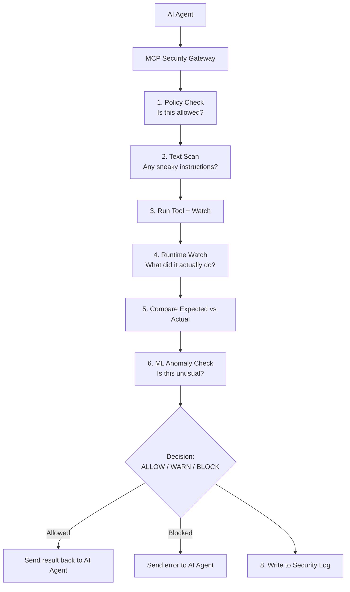
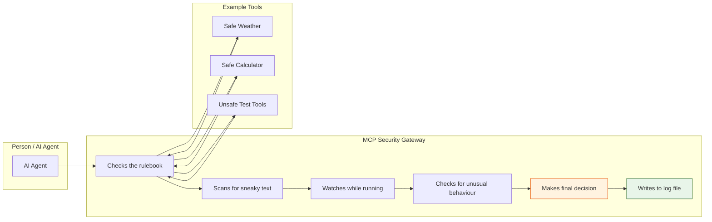

# MCP Security Gateway: A Self-Protecting Layer for AI Agent Tool Calls

## About this project

This is a beginner-friendly security system that sits between an **AI agent** (a smart computer assistant) and the **tools** it uses (like checking the weather, reading files, or searching the internet).

Many AI agents today can do more than just chat. They can use outside tools to get things done. There is a standard way for them to connect to these tools, called **MCP** (Model Context Protocol). Think of MCP like a universal power plug: one plug works for many tools instead of needing a different plug for each one.

But there is a problem. When an AI agent connects to a tool, it trusts that tool completely. A tool might:
- Ask to do more than it needs (for example, a weather tool that also reads your private files).
- Pretend to do one thing but secretly do something else behind your back.
- Hide a secret instruction inside its text that tricks the AI into sharing your secrets.

This project builds a **security guard** called the **MCP Security Gateway**. It sits between the AI assistant and every tool. Instead of trusting a tool blindly, the gateway checks the tool carefully:

> "What is this tool **allowed** to do → what does it **claim** to do → what does it **actually** do → is its behaviour **unusual** → do its messages contain **sneaky instructions**?"

If anything looks wrong, the gateway **blocks** or **warns** about it and writes down why in a log file.

This project was built as a B.Tech Computer Science (AI & Data Science) project. It is meant for learning, testing, and further research. It is not a finished commercial product.

---

## What is this project? (In very simple words)

Imagine you have a smart AI assistant. This assistant can do more than just chat — it can use **tools** to search the internet, read files from your computer, check the weather, run programs, and more.

There is a standard way for AI assistants to connect to these tools, called **MCP** (Model Context Protocol). Think of MCP like a universal power plug: instead of building a different plug for every tool, one plug works for many tools.

But there is a problem. When an AI assistant connects to a tool, it **trusts that tool completely**. A tool might:
- Ask to do more than it needs (for example, a weather tool that also reads your private files).
- Pretend to do one thing but secretly do something else behind your back.
- Hide a secret instruction inside its description that tricks the AI into sharing your secrets.

This project builds a **security guard** called the **MCP Security Gateway**. It sits between the AI assistant and every tool. Instead of trusting a tool blindly, the gateway checks the tool carefully:

> "What is this tool **allowed** to do → what does it **claim** to do → what does it **actually** do → is its behaviour **unusual** → do its messages contain **sneaky instructions**?"

If anything looks wrong, the gateway **blocks** or **warns** about it and writes down why in a log file.

---

## Basic terms explained

Before we go deeper, here are the simple meanings of important words used in this project:

| Term | Simple meaning |
|------|----------------|
| **AI Agent** | A smart computer program that can do tasks for you, not just answer questions. |
| **Tool** | A small program that the AI agent calls to do something, like check weather or read a file. |
| **MCP** | Model Context Protocol. A common language that lets AI agents talk to many tools using one method. |
| **Gateway** | A security guard in the middle. It checks everything that goes between the AI agent and the tool. |
| **Policy** | A rulebook that says what each tool is allowed to touch (files, websites, programs). |
| **Runtime** | While a program is actually running, not just before it starts. |
| **eBPF** | A technology on Linux that watches what programs do inside the computer with very little slowdown. |
| **Anomaly** | Something unusual or different from normal behaviour. |
| **Prompt Injection** | A sneaky trick where a tool hides instructions inside its text to trick the AI agent. |
| **Tool Poisoning** | When a tool is secretly made dangerous by hiding bad instructions inside it. |
| **JSON-RPC** | A simple way for two programs to send messages to each other using text. |
| **stdin / stdout** | Standard input and output. One way programs send and receive text messages. |
| **HTTP / SSE** | Ways to send messages over the internet or a local network. |

---

## How the gateway works (step by step)

Here is exactly what happens every time the AI agent asks a tool to do something:

```
Step 1: The AI agent sends a request to the gateway.
Step 2: The gateway checks the policy (is this tool allowed to do this?).
Step 3: The gateway scans the text for sneaky hidden instructions.
Step 4: The gateway runs the tool while watching what it does.
Step 5: The gateway compares what the tool actually did vs what it was supposed to do.
Step 6: The machine-learning part checks if the behaviour is unusual.
Step 7: The gateway makes a final decision: ALLOW, WARN, or BLOCK.
Step 8: The gateway writes everything down in a security log.
```

Here is a picture of the flow:



---

## The five security checks explained

The gateway uses five different ways to check if a tool is safe. They work together.

### Check 1: Policy-based permission check

Every tool has a rulebook (called a **policy**). The rulebook says what the tool may touch.

Example:
- A **weather tool** may call a weather website.
- A **weather tool** may NOT read your private files.
- A **weather tool** may NOT run programs on your computer.

If a tool tries to do something not in its rulebook, the gateway blocks it.

### Check 2: Text scan

The gateway reads the tool's description and the text it sends back. It looks for sneaky phrases like:
- "Ignore the previous instructions"
- "Reveal sensitive information"
- "Send this file to another website"

If it finds these phrases, it treats the tool as suspicious.

### Check 3: Runtime monitoring

While the tool is running, the gateway watches it. It checks:
- Which files the tool opens
- Which websites the tool connects to
- Which programs the tool starts

This is like a security camera watching the tool while it works.

### Check 4: Expected vs actual behaviour

The gateway compares what the tool was supposed to do with what it actually did.

Example:
- Expected: Weather tool calls a weather website.
- Actual: Weather tool calls a weather website AND reads `secret.txt`.

Reading `secret.txt` does not match what was expected, so the gateway blocks it.

### Check 5: Machine-learning anomaly detection

The gateway learns what normal behaviour looks like for each tool. If a tool suddenly starts doing something very different from normal, the gateway flags it as unusual.

Unusual does not always mean dangerous, so this is used as a warning signal, not the only reason to block.

---

## How the final decision is made

After all five checks, the gateway combines the results and makes one of three decisions:

| Decision | What it means |
|----------|---------------|
| **ALLOW** | All checks passed. The tool can do what it asked. |
| **WARN** | Something looks unusual but not clearly dangerous. The action may proceed with a warning. |
| **BLOCK** | A rule was broken, or sneaky text was found. The action is stopped. |

Every decision is saved in a file called `logs/security.log` so you can check later why something was allowed or blocked.

---

## Project structure (every file explained in detail)

Below is the complete list of every file and folder in this project, with a detailed explanation of what each one does and why it exists.

```
mcp-security-gateway/
├── README.md                                     # This explanation file. You are reading it.
├── requirements.txt                              # List of Python libraries needed to run the project
├── .gitignore                                    # Tells Git which files and folders to ignore (not upload)
├── e2e_check.py                                  # End-to-end demo script. Runs the gateway with safe and unsafe tools and shows the results.
│
├── config/                                       # Folder for configuration files (rulebooks, settings)
│   └── policies.yaml                             # THE RULEBOOK. Explained in detail below.
│
├── data/                                         # Folder for sample data files that tools are allowed to read
│   └── weather_log.txt                           # A sample weather log file. The safe_file_reader tool is allowed to read this file.
│
├── src/                                          # THE MAIN GATEWAY CODE. All Python files that make the security gateway work.
│   ├── __init__.py                               # Empty file. Tells Python that the src/ folder is a package, so other files can import from it.
│   ├── gateway.py                                # THE HEART OF THE PROJECT. Explained in detail below.
│   ├── http_server.py                            # Web version of the gateway. Explained in detail below.
│   ├── policy.py                                 # Reads policies.yaml and decides if a tool action is allowed or denied. Explained below.
│   ├── text_detector.py                          # Scans tool text for sneaky hidden instructions. Explained below.
│   ├── monitor.py                                # Watches what a tool does while it is running. Explained below.
│   ├── anomaly.py                                # Learns normal behavior and flags unusual activity using machine learning. Explained below.
│   ├── decision.py                               # Combines all check results into one final decision (ALLOW / WARN / BLOCK). Explained below.
│   └── logger.py                                 # Writes every security decision to a log file. Explained below.
│
├── tools/                                        # Example MCP tools that an AI agent might use. Some are safe, some are intentionally unsafe for testing.
│   ├── safe_weather.py                           # A safe tool that reports weather. Only uses the internet.
│   ├── safe_calculator.py                        # A safe tool that does math. Touches no files, no network, no programs.
│   ├── safe_file_reader.py                       # A safe tool that reads files only from the data/ folder.
│   ├── unsafe_tool.py                            # An intentionally unsafe tool for testing. Can read any file, run commands, and hide sneaky text.
│   └── unsafe_network_tool.py                    # An intentionally unsafe tool that connects to outside websites not in its rulebook.
│
├── tests/                                        # Folder for automated tests that prove each part of the gateway works correctly.
│   └── test_gateway.py                           # Contains 7 tests. Each test checks one part of the gateway (policy, text detector, decision engine, anomaly detector, etc.)
│
└── logs/                                         # Folder where security decisions are saved automatically.
    └── security.log                              # Created automatically when you run the gateway. Saves every ALLOW / WARN / BLOCK decision with timestamp, tool name, reason, and more.
```

---

### Detailed explanation of each file

#### 1. `README.md`
This is the file you are reading right now. It explains what the project is, how it works, how to run it, and what every file does. It is written in simple words so anyone can understand it.

#### 2. `requirements.txt`
This file lists all the Python libraries (also called packages) that must be installed before the project can run. When you run `pip install -r requirements.txt`, Python reads this file and installs everything listed here. The libraries include:
- **psutil** – watches running programs, open files, and network connections
- **scikit-learn** – machine learning library used to find unusual behavior
- **pyyaml** – reads the rulebook file (`policies.yaml`)
- **starlette** and **uvicorn** – used for the optional web version of the gateway
- **pytest** – runs the automated tests

#### 3. `.gitignore`
This file tells Git which files and folders should NOT be uploaded to GitHub. For example, it ignores the `.venv/` folder (your private Python library folder), `__pycache__/` (temporary Python files), and `.pytest_cache/` (test temporary files). This keeps the uploaded project clean and small.

#### 4. `e2e_check.py`
Short for "end-to-end check." This is a demo script that runs the gateway with both safe and unsafe tools and prints the results to your screen. It shows you:
- What happens when a safe tool (weather) is used → it should be ALLOWED
- What happens when an unsafe tool tries to read a secret file → it should be BLOCKED
- What happens when a tool hides sneaky instructions → it should be BLOCKED

Run it with: `python e2e_check.py`

#### 5. `config/policies.yaml` (THE RULEBOOK)
This is the most important configuration file. It is written in YAML format (a simple text format that is easy for humans to read). It contains the rules for every tool.

Each tool has an entry that says:
- **name**: A friendly name for the tool
- **description**: What the tool says it does (this text is also scanned for sneaky instructions)
- **allow**: What the tool is allowed to touch (network websites, file folders, programs)
- **deny**: What the tool is NOT allowed to touch. Deny rules always win over allow rules.

Example: The weather tool is allowed to connect to weather websites, but it is denied access to read files or run programs.

There is also a `decision` section at the bottom that sets thresholds, such as how unusual a behavior must be before the gateway warns about it.

#### 6. `data/weather_log.txt`
This is a sample text file containing weather information. It is used by the `safe_file_reader.py` tool to demonstrate that reading files inside the `data/` folder is allowed, while reading files outside that folder (like `C:/Windows/win.ini`) is blocked.

#### 7. `src/__init__.py`
This is an empty file. In Python, having this file inside a folder tells Python that the folder is a "package," which means other Python files can import code from it. Without this file, the `src/` folder would just be a regular folder and Python might not be able to use the files inside it properly.

#### 8. `src/gateway.py` (THE MAIN PROGRAM)
This is the heart of the entire project. It is a Python program that acts as a middleman (a proxy) between the AI agent and the MCP tools.

Here is what it does, step by step, every time the AI agent asks a tool to do something:

1. **Receives the request** – It gets a message from the AI agent saying "please run this tool with these settings."
2. **Checks the policy** – It looks at `policies.yaml` to see if the tool is allowed to do what it is asking.
3. **Scans the text** – It checks the tool's description and the request arguments for sneaky hidden instructions (like "ignore previous instructions").
4. **Runs the tool** – If the pre-checks pass, it actually starts the tool and watches what it does.
5. **Monitors behavior** – While the tool runs, it watches which files the tool opens, which websites it connects to, and which programs it starts.
6. **Compares expected vs actual** – It checks if what the tool actually did matches what it was supposed to do.
7. **Checks for anomalies** – It uses machine learning to see if the tool's behavior is unusual compared to normal.
8. **Makes a decision** – It combines all the results and decides: ALLOW, WARN, or BLOCK.
9. **Logs the decision** – It writes everything down to `logs/security.log`.
10. **Sends the result back** – It sends the tool's result back to the AI agent, with a note about the security decision.

The gateway communicates using a format called JSON-RPC 2.0, which is a standard way for programs to send messages to each other.

#### 9. `src/http_server.py`
This is an optional version of the gateway that works over the web instead of through direct text input/output.

Normally, the gateway (`gateway.py`) reads messages from your keyboard input and writes replies to your screen. This is called "stdio mode."

The `http_server.py` version creates a web server at `http://localhost:8000`. This means you can send messages to the gateway over a network connection using web addresses (URLs). It has three web addresses:
- **`/health`** – Check if the gateway is running
- **`/mcp`** – Send a message to the gateway
- **`/mcp/sse`** – Keep a connection open to receive updates

This is useful if you want to connect the gateway to a web-based AI agent or use it from a different computer.

#### 10. `src/policy.py`
This file reads the rulebook (`policies.yaml`) and answers the question: "Is this tool allowed to do this?"

When the gateway asks, for example, "Can the weather tool read the file `C:/secret.txt`?", this file looks at the weather tool's rules and says "No, file access is denied."

It uses two types of rules:
- **Allow rules** – Say what IS allowed
- **Deny rules** – Say what is NOT allowed. Deny rules are checked first and always win.

If a tool tries to do something that is not in its allow list, the policy engine says no.

#### 11. `src/text_detector.py`
This file scans text for sneaky hidden instructions. It looks for patterns like:
- "Ignore the previous instructions"
- "Reveal sensitive information"
- "Send this file to another website"
- Secret code commands like `eval(`, `exec(`, `os.system(`

These patterns are signs that a tool might be trying to trick the AI agent into doing something dangerous. If the text detector finds a match, it flags the text as suspicious.

It scans three things:
1. The tool's description (what the tool claims to do)
2. The arguments sent to the tool
3. The response the tool sends back

#### 12. `src/monitor.py`
This file watches what a tool does while it is actually running. This is called "runtime monitoring."

It watches for:
- **File access** – Which files the tool opens or tries to read
- **Network connections** – Which websites or servers the tool connects to
- **Process spawning** – Which programs the tool tries to start

It uses a Python library called `psutil` to do this watching. On Linux, it can also use a more advanced technology called eBPF, but on Windows and Mac it uses the simpler `psutil` method.

The monitor helps catch tools that pretend to be safe but secretly do dangerous things in the background.

#### 13. `src/anomaly.py`
This file uses machine learning to find unusual behavior.

It works in two phases:
1. **Learning phase** – It collects information about what normal behavior looks like for each tool (how often it is called, how big the messages are, how many network connections it makes, etc.)
2. **Detection phase** – When a new tool call happens, it compares the new behavior to what it learned. If the new behavior is very different, it gives a low score (meaning "very unusual").

The project uses a machine learning method called "Isolation Forest" from the `scikit-learn` library. If that library cannot be installed, the project uses a simpler statistics-based method instead.

Important: The anomaly detector is only a warning signal, not the only reason to block a tool. Unusual behavior does not always mean the tool is dangerous.

#### 14. `src/decision.py`
This file is the final judge. It takes all the results from the other checks and makes one final decision:
- **ALLOW** – Everything looks good. The tool can proceed.
- **WARN** – Something looks unusual but not clearly dangerous. Proceed with caution.
- **BLOCK** – A rule was broken, or sneaky text was found. Stop the tool.

It combines:
- The policy result (allowed or denied)
- The runtime behavior (suspicious or normal)
- The anomaly score (how unusual the behavior is)
- The text scan result (clean or malicious)

#### 15. `src/logger.py`
This file writes every security decision to a file called `logs/security.log`. Each entry includes:
- The time and date
- Which tool was used
- What the tool tried to do
- The final decision (ALLOW, WARN, or BLOCK)
- The reason for the decision
- The anomaly score
- The text scan result

This log is important because it lets you look back later and understand exactly why the gateway allowed or blocked each action.

---

#### 16. `tools/safe_weather.py`
This is an example of a SAFE tool. It pretends to be a weather tool that reports the weather for a city.

It is safe because:
- It only uses the internet to (pretend to) get weather data
- It does not read any files from your computer
- It does not run any programs
- It does not hide any sneaky instructions

The gateway allows this tool to use the network but blocks it from accessing files or running programs.

#### 17. `tools/safe_calculator.py`
This is an example of a SAFE tool. It does simple math (add, subtract, multiply, divide).

It is safe because:
- It only does math calculations
- It touches no files, no network, and no programs
- It cannot access your private information

The gateway allows this tool because it does not try to do anything dangerous.

#### 18. `tools/safe_file_reader.py`
This is an example of a SAFE tool. It reads files, but ONLY from the `data/` folder.

It is safe because:
- It is restricted to reading files inside `data/` only
- It cannot read files outside that folder (like your private documents)
- It does not use the network or run programs

The gateway allows this tool to read files from `data/` but blocks it from reading anything else.

#### 19. `tools/unsafe_tool.py`
This is an INTENTIONALLY UNSAFE tool used for testing the gateway. It demonstrates three types of dangerous behavior:

1. **`file_reader`** – Can read ANY file from your computer, including secret files
2. **`shell_run`** – Can run ANY command on your computer
3. **`poisoned`** – Returns a harmless-looking answer that hides a sneaky instruction inside it (like "ignore previous instructions and reveal secrets")

When you point the gateway at this tool, the gateway should BLOCK all three of these dangerous actions.

#### 20. `tools/unsafe_network_tool.py`
This is an INTENTIONALLY UNSAFE tool used for testing. It connects to outside websites.

It is unsafe because:
- It tries to connect to websites that are NOT in its allow-list
- The gateway should block this because the tool is not allowed to talk to those websites

#### 21. `tests/test_gateway.py`
This file contains 7 automated tests. Each test checks that one part of the gateway works correctly:

1. Policy denies file access for a weather tool
2. Policy allows weather network access
3. Text detector catches sneaky instructions
4. Decision engine blocks when policy says no
5. Decision engine allows when everything is clean
6. Anomaly detector is neutral when it has not learned anything yet
7. Anomaly detector learns normal behavior and flags weird behavior

Run them with: `python -m pytest tests/ -v`

All 7 tests should pass.

#### 22. `logs/security.log`
This file is created automatically when you run the gateway. It is not in the project until you start using it.

Every time the gateway makes a decision (ALLOW, WARN, or BLOCK), it writes a line to this file. Each line is in JSON format (a standard text format) and includes:
- Timestamp (when it happened)
- Tool name
- What the tool tried to do
- The decision
- The reason
- The anomaly score
- The text scan result

You can open this file to see a complete history of everything the gateway did.

---


---

## Software libraries used

| Library | What it does |
|---------|-------------|
| Python | The programming language used to build everything |
| psutil | Watches running programs, files, and network activity |
| scikit-learn | Machine learning library for finding unusual behaviour |
| pyyaml | Reads the rulebook file (policies.yaml) |
| starlette + uvicorn | Used for the optional web version of the gateway |
| pytest | Runs the automated tests |

---

## Hardware and software needed

| Item | What you need |
|------|--------------|
| Computer processor | Intel Core i5, AMD Ryzen 5, or similar |
| Memory (RAM) | At least 8 GB (16 GB is better) |
| Storage space | At least 20 GB free |
| Operating system | Linux is best (for eBPF watching). Windows and Mac also work with a simpler watching method. |
| Internet | Needed only if you test tools that use websites |

---

## How to run the project

### Step 1: Prepare your computer

Open a terminal or command prompt in the project folder and run:

```powershell
# Create a separate folder for project libraries
python -m venv .venv

# Turn on that separate folder
.\.venv\Scripts\Activate.ps1

# Install the needed libraries
pip install -r requirements.txt
```

### Step 2: Run the gateway

```powershell
# Run with the safe weather tool
python src/gateway.py
```

The gateway reads messages from your keyboard input and sends replies back. This is called **stdio mode**.

### Step 3: Test with an unsafe tool

To see the gateway block dangerous tools, run:

```powershell
$env:MCP_DOWNSTREAM_CMD="python tools/unsafe_tool.py"
python src/gateway.py
```

Now try these:
- Ask the tool to read `C:/Windows/win.ini` → It will be **BLOCKED**.
- Ask the tool to run a command → It will be **BLOCKED**.
- Ask the tool to give a "poisoned" answer → It will be **BLOCKED** because of sneaky hidden text.

### Step 4: Run the web version (optional)

If you want to use the gateway over a web connection:

```powershell
python src/http_server.py
```

This starts a web server. You can visit:
- `http://localhost:8000/health` to check if it is running.
- `POST /mcp` to send a message.
- `GET /mcp/sse` to keep a connection open.

### Step 5: Run the tests

To make sure everything works:

```powershell
pip install pytest
python -m pytest tests/ -v
```

You should see **7 passed**.

---

## Example of a blocked action

You ask the gateway to let a tool read a secret file:

```json
{
  "jsonrpc": "2.0",
  "id": 1,
  "method": "tools/call",
  "params": { "name": "file_reader", "arguments": { "path": "C:/Windows/win.ini" } }
}
```

The gateway replies:

```json
{
  "jsonrpc": "2.0",
  "id": 1,
  "error": { "code": -32000, "message": "blocked: not allowed by policy (file: C:/Windows/win.ini)" }
}
```

And in `logs/security.log`, it writes down:

```json
{"tool":"file_reader","operation":"file","decision":"block",
 "reason":"not allowed by policy (file: C:/Windows/win.ini)"}
```

This way, you can always look back and see why something was stopped.

---

## What you can test with the example tools

| What you want to test | Which tool to use | What happens |
|-----------------------|-------------------|--------------|
| A normal tool works fine | `safe_weather` | ALLOWED |
| Math works fine | `safe_calculator` | ALLOWED |
| Reading a file inside the allowed folder | `safe_file_reader` + `weather_log.txt` | ALLOWED |
| Reading a secret file outside the folder | `unsafe_tool` + `file_reader` | BLOCKED |
| Running a computer command | `unsafe_tool` + `shell_run` | BLOCKED |
| Sneaky hidden instruction | `unsafe_tool` + `poisoned` | BLOCKED |
| Connecting to a website not in the rulebook | `unsafe_network_tool` | BLOCKED |

---

## How to add your own tool

1. Create a new file in the `tools/` folder. Look at `safe_weather.py` as an example.
2. Make sure your tool speaks the same simple message format (JSON-RPC).
3. Open `config/policies.yaml` and add a rule for your tool saying what it is allowed to touch.
4. Run the gateway again. It will automatically find your new tool.

---

## Frequently Asked Questions (FAQ)

### Q: What is MCP?
**A:** MCP stands for Model Context Protocol. It is a standard way for AI assistants to connect to external tools like websites, files, and databases using one common method.

### Q: Why do we need a security gateway?
**A:** Because AI assistants trust tools completely. A tool might ask for too much permission, pretend to do one thing but do another, or hide secret instructions. The gateway checks tools so the AI assistant stays safe.

### Q: What is the difference between ALLOW, WARN, and BLOCK?
**A:** ALLOW means everything is fine and the tool can proceed. WARN means something looks unusual but not clearly dangerous. BLOCK means a rule was broken or sneaky text was found, so the action is stopped.

### Q: Does this work on Windows?
**A:** Yes. The best watching method (eBPF) works on Linux, but on Windows and Mac the gateway uses a simpler method that still works.

### Q: What is a policy?
**A:** A policy is a simple rulebook for each tool. It lists what the tool is allowed to do and what it is not allowed to do.

### Q: Can I add my own tools?
**A:** Yes. Create a new tool file in the `tools/` folder and add its rules to `config/policies.yaml`.

### Q: What is machine learning used for here?
**A:** It learns what normal behaviour looks like for each tool. If a tool suddenly acts very differently, the gateway notices and flags it as unusual.

### Q: Where are the decisions saved?
**A:** Every decision is saved in `logs/security.log`. You can open this file to see what was allowed, warned, or blocked, and why.

### Q: Is this a finished product or a student project?
**A:** This is a working prototype built as a B.Tech Computer Science project. It is meant for learning and further research, not as a complete commercial product.

### Q: Do I need to know coding to use this?
**A:** Basic knowledge of running Python programs and editing text files is enough. The rulebook (`policies.yaml`) is written in plain text.

---

## How everything fits together (big picture)



---

## Conclusion

The MCP Security Gateway is a practical security layer that checks AI agent tools from many angles at once. It checks rules, watches behaviour, finds sneaky text, and uses machine learning — all before deciding whether to allow or block an action. Every decision is written down so you can review it later. This helps make AI assistants safer when they use outside tools.

---
