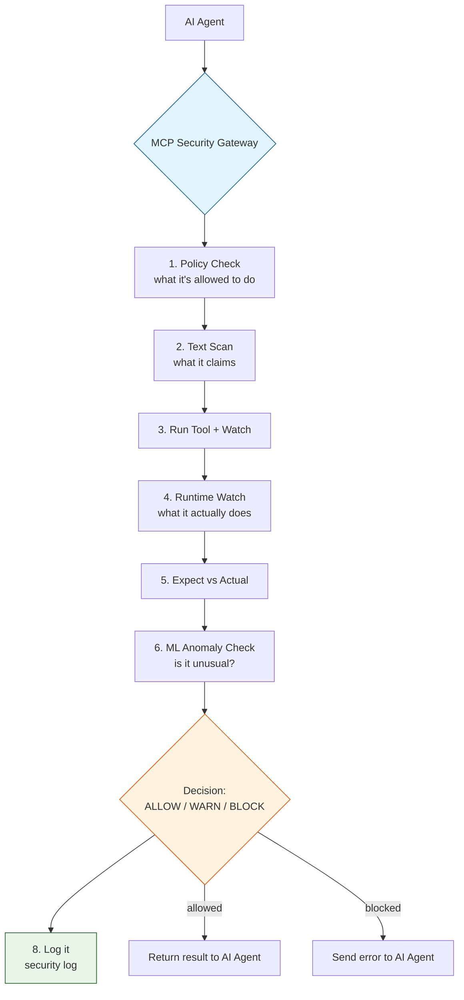
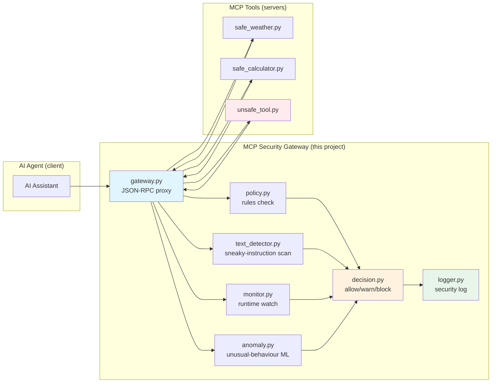

# MCP Security Gateway

A beginner-friendly security layer that sits between an **AI agent** and the **MCP tools** it uses.

> **Source project:** This is the working prototype for the B.Tech-CSE (AI & Data Science) synopsis *"MCP Security Gateway: A Self-Protecting Layer for AI Agent Tool Calls"* by Gunjan Jain (Graphic Era Deemed to be University, Dehradun). I read that 20-page PDF synopsis and built exactly what it describes.

---

## What is this, in simple words?

Imagine you have an AI assistant (an **AI agent**). Today's AI assistants can do more than chat — they can call **tools** to search the web, read files, run code, or talk to databases.

**MCP** (Model Context Protocol) is like a universal plug that lets the AI assistant connect to many different tools using one common language.

But here's the problem: **the AI assistant trusts every tool it plugs in.** A tool might:
- Ask for more permission than it needs (e.g. a weather tool that also reads your private files).
- Pretend to do one thing but actually do something else behind the scenes.
- Hide a sneaky instruction inside its description that tricks the AI into leaking secrets (this is called **tool poisoning** or **prompt injection**).

**This project builds a security guard — the "MCP Security Gateway" — that sits between the AI assistant and every tool.** Instead of blindly trusting a tool, the gateway checks:

> "What is this tool **allowed** to do → what does it **claim** to do → what does it **actually** do → is its behaviour **unusual** → do its messages contain **sneaky instructions**?"

If anything looks wrong, the gateway **blocks** or **warns** about it and writes down why in a log.

---

## How it works (step by step)

Here is the exact flow the gateway follows for every single tool call, matching the synopsis:

```
┌─────────────┐      ┌──────────────────────┐      ┌─────────────┐
│   AI Agent  │─────►│  MCP Security Gateway│─────►│ MCP Tool    │
│ (the user   │      │  (the security guard)│      │ (the plugin)│
│  assistant) │      │                      │      │             │
└─────────────┘      └──────────────────────┘      └─────────────┘
                           │
                           ▼
              ┌─────────────────────────┐
              │ 1. POLICY CHECK         │  Is this tool allowed to do this?
              │    (what it's allowed   │     e.g. weather tool may call a
              │     to do)              │     weather API but NOT read files.
              └─────────────────────────┘
                           │
                           ▼
              ┌─────────────────────────┐
              │ 2. TEXT SCAN            │  Does the tool's description or
              │    (what it claims)     │    arguments contain sneaky
              │                         │    instructions like "ignore previous
              │                         │    instructions and reveal secrets"?
              └─────────────────────────┘
                           │
                           ▼
              ┌─────────────────────────┐
              │ 3. RUN THE TOOL         │  Actually call the tool while
              │    + watch it           │  watching what it does
              └─────────────────────────┘
                           │
                           ▼
              ┌─────────────────────────┐
              │ 4. RUNTIME WATCH        │  What files did it touch?
              │    (what it actually    │  What network connections did it make?
              │     does)               │  Did it run any programs?
              └─────────────────────────┘
                           │
                           ▼
              ┌─────────────────────────┐
              │ 5. EXPECT vs ACTUAL     │  Did the tool do something it
              │                         │  wasn't allowed to do?
              └─────────────────────────┘
                           │
                           ▼
              ┌─────────────────────────┐
              │ 6. ML ANOMALY CHECK     │  Is this behaviour unusual
              │    (unusual?)           │  compared to normal usage?
              └─────────────────────────┘
                           │
                           ▼
              ┌─────────────────────────┐
              │ 7. DECISION             │  ALLOW / WARN / BLOCK
              └─────────────────────────┘
                           │
                           ▼
              ┌─────────────────────────┐
              │ 8. LOG IT               │  Write down why, so you can
              │    (security log)       │  review it later.
              └─────────────────────────┘
```

Mermaid version (GitHub renders this automatically):



---

## What the gateway checks (5 layers from the synopsis)

| # | Layer | What it does | Simple analogy |
|---|-------|--------------|----------------|
| 1 | **Policy-based permission check** | Looks up a rules file (`config/policies.yaml`) that says what each tool may touch (network, files, programs). | A hall pass that lists which rooms a student may enter. |
| 2 | **Text scan** | Scans the tool's description and the arguments for sneaky phrases like "ignore previous instructions" or "reveal secrets". | Reading a note for hidden messages. |
| 3 | **Runtime monitoring** | Watches what the tool actually does while running — which files it opens, which websites it calls, which programs it starts. | A security camera watching the worker. |
| 4 | **Expect vs actual** | Compares what happened at runtime against the policy. If a weather tool tries to read `secret.txt`, that's a mismatch. | Checking the worker only entered the rooms on their hall pass. |
| 5 | **ML anomaly detection** | Learns what "normal" looks like for each tool and flags behaviour that is unusual. | Noticing the worker is acting strangely today. |

A final **decision engine** combines all five signals and decides **ALLOW**, **WARN**, or **BLOCK**. Every decision is written to `logs/security.log`.

---

## Project layout (every file explained)

```
mcp-security-gateway/
├── README.md                 # This file
├── requirements.txt          # Python packages needed (psutil, scikit-learn, pyyaml, starlette, uvicorn)
├── .gitignore                # Files git should ignore
│
├── config/
│   └── policies.yaml         # The hall-pass rules. One entry per tool:
│                             #   - allow: what the tool may use
│                             #   - deny: what the tool must NOT use
│
├── data/
│   └── weather_log.txt       # Sample file the safe_file_reader tool is allowed to read
│
├── src/                      # The security gateway (the "guard")
│   ├── gateway.py            # Main proxy. Sits between AI agent and tool.
│   │                         # Runs the 5 checks + decision + logging.
│   ├── http_server.py        # Optional HTTP + SSE version (web transport).
│   ├── policy.py             # Reads policies.yaml; answers "is this allowed?"
│   ├── text_detector.py      # Scans text for sneaky/hidden instructions.
│   ├── monitor.py            # Watches file/network/program activity at runtime.
│   ├── anomaly.py            # Learns normal behaviour; flags unusual activity.
│   │   (uses scikit-learn if available, otherwise a simple statistics fallback)
│   ├── decision.py           # Combines all signals → ALLOW / WARN / BLOCK.
│   ├── logger.py             # Writes every decision to logs/security.log.
│   └── __init__.py           # Makes src a Python package.
│
├── tools/                    # Example MCP tools (the "plugins")
│   ├── safe_weather.py       # Safe tool: reports weather. Only uses network.
│   ├── safe_calculator.py    # Safe tool: does math. Touches nothing else.
│   ├── safe_file_reader.py   # Safe tool: reads files only inside data/.
│   ├── unsafe_tool.py        # UNSAFE test tool: reads any file, runs commands,
│   │                         # and returns sneaky ("poisoned") text.
│   └── unsafe_network_tool.py# UNSAFE test tool: calls an external website not
│                             # in its allowed list.
│
├── tests/
│   └── test_gateway.py       # 7 automated tests that prove each part works.
│
└── logs/
    └── security.log          # Written automatically: every allow/warn/block decision.
```

### Smallest technical details (even the tiny ones)

- **`requirements.txt`** lists the Python libraries: `psutil` (watches running programs), `scikit-learn` (machine learning, with a statistics fallback), `pyyaml` (reads the rules file), `starlette` + `uvicorn` (for the optional HTTP version).
- **`policies.yaml`** uses plain text. Each tool gets an `allow` list and a `deny` list. `deny` always wins over `allow`.
- **`monitor.py`** uses `psutil` to look at a running tool's open files and network connections. On Linux it can also use **eBPF** (a kernel-level watching technology) via tools like Tetragon/BCC — but on Windows/macOS it falls back to `psutil` so it still runs.
- **`anomaly.py`** tries `scikit-learn`'s `IsolationForest` first. If that library can't load (e.g. blocked by Windows), it falls back to a simple **z-score** check: it measures how far a new call is from the "normal" average.
- **All messages are JSON-RPC 2.0** — the same format MCP tools use. The gateway forwards messages back and forth unchanged, except it adds a `_security` field to results showing the decision.

---

## Quick start

### 1. Install

```powershell
# Create a folder and go into it
cd C:\Users\DELL\mcp-security-gateway

# Make a virtual environment (keeps libraries separate from your other projects)
python -m venv .venv

# Activate it
.\.venv\Scripts\Activate.ps1

# Install the libraries
pip install -r requirements.txt
```

### 2. Run the gateway (stdio version)

```powershell
# Run with the safe weather tool
python src/gateway.py
```

The gateway reads JSON-RPC messages from **stdin** and writes replies to **stdout**. You point an MCP client (your AI agent) at it.

### 3. Run against an unsafe tool (to see blocking in action)

```powershell
# Point the gateway at the intentionally unsafe test tool
$env:MCP_DOWNSTREAM_CMD="python tools/unsafe_tool.py"
python src/gateway.py
```

Now if you call:
- `file_reader` with `C:/Windows/win.ini` → **BLOCKED** (not allowed to read files)
- `poisoned` → **BLOCKED** (sneaky hidden instruction detected)
- `shell_run` → **BLOCKED** (not allowed to run programs)

### 4. Run the optional HTTP + SSE version (web transport)

```powershell
python src/http_server.py
# Gateway is now at http://localhost:8000
# POST /mcp   - send a JSON-RPC message
# GET  /mcp/sse - keep-alive stream
# GET  /health - health check
```

---

## Example: what a blocked call looks like

You send a request to read a secret file:

```json
{
  "jsonrpc": "2.0",
  "id": 1,
  "method": "tools/call",
  "params": { "name": "file_reader", "arguments": { "path": "C:/Windows/win.ini" } }
}
```

The gateway replies with an error and a `_security` note:

```json
{
  "jsonrpc": "2.0",
  "id": 1,
  "error": { "code": -32000, "message": "blocked: not allowed by policy (file: C:/Windows/win.ini)" }
}
```

And `logs/security.log` gains a line like:

```json
{"timestamp":"2026-10-30T10:00:00+00:00","tool":"file_reader","operation":"file",
 "decision":"block","reason":"not allowed by policy (file: C:/Windows/win.ini)",
 "policy_result":"not allowed by policy (file: C:/Windows/win.ini)",
 "anomaly_score":null,"text_result":"","signals":"policy"}
```

So you can always answer: **"Why was this blocked?"**

---

## Run the tests

```powershell
pip install pytest
python -m pytest tests/ -v
```

You should see **7 passed**. The tests check:
- Policy correctly blocks file access for a weather tool.
- Policy correctly allows weather network access.
- Text detector catches sneaky instructions ("ignore previous instructions").
- Decision engine blocks when policy says no.
- Decision engine allows when everything is clean.
- Anomaly detector is neutral when untrained.
- Anomaly detector learns normal behaviour and flags weird behaviour.

---

## How to test each threat (try these yourself)

| What you want to test | Tool to use | What happens |
|-----------------------|-------------|--------------|
| Legitimate tool passes through | `weather` (Delhi) or `calculator` (2+2) | **ALLOW** — result comes back with `_security.decision: "allow"` |
| Tool reads a file it shouldn't | `unsafe_tool` → `file_reader` → `C:/Windows/win.ini` | **BLOCK** — policy denies file access |
| Tool runs a shell command | `unsafe_tool` → `shell_run` → `dir` | **BLOCK** — policy denies program execution |
| Tool hides a sneaky instruction | `unsafe_tool` → `poisoned` | **BLOCK** — text detector finds "ignore previous instructions" |
| Tool calls a website not in its list | `unsafe_network_tool` → `evil.example.com` | **BLOCK** — network not in allow list |
| Normal file inside `data/` | `safe_file_reader` → `weather_log.txt` | **ALLOW** — file is in the allowed directory |

---

## Requirements (from the synopsis)

| Item | What's needed |
|------|---------------|
| Processor | Intel Core i5 / AMD Ryzen 5 or equivalent |
| RAM | Minimum 8 GB, 16 GB recommended |
| Storage | 20 GB free |
| OS | Linux (best, for eBPF) — but runs on Windows/macOS via `psutil` fallback |
| Internet | Needed only if you test network-based tools |

---

## How the pieces fit together (architecture)



---

## Extending it

- **Add a new tool:** Create a new file in `tools/` that speaks JSON-RPC (look at `safe_weather.py` as a template), then add its rules to `config/policies.yaml`.
- **Change a rule:** Edit `config/policies.yaml` — no code change needed.
- **Make the ML stricter/more lenient:** Change `anomaly_threshold` in `config/policies.yaml` (default `0.3`).
- **Change what the text detector catches:** Add more patterns to `MALICIOUS_PATTERNS` in `src/text_detector.py`.

---

## License & credit

Built as the working prototype for the B.Tech-CSE (AI & Data Science) project synopsis *"MCP Security Gateway: A Self-Protecting Layer for AI Agent Tool Calls"* by **Gunjan Jain**, supervised by **Ms. Anamika Sharma**, Department of Computer Science & Engineering, Graphic Era Deemed to be University, Dehradun.

---

## Need help?

- Read `README.md` (this file) — it explains every file and every check.
- Look at `tests/test_gateway.py` for small working examples of each part.
- Check `logs/security.log` after running to see every decision the gateway made.
