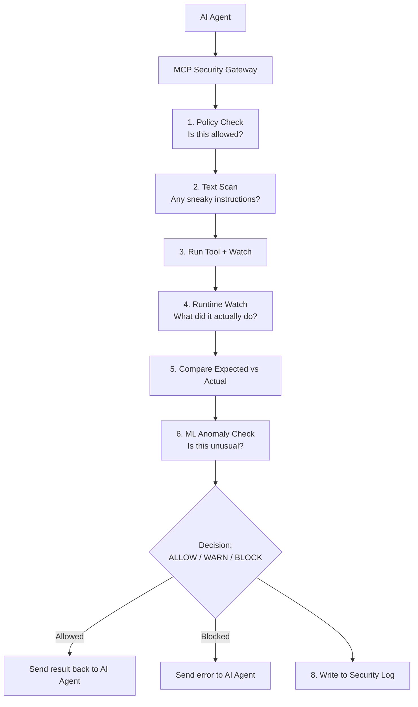
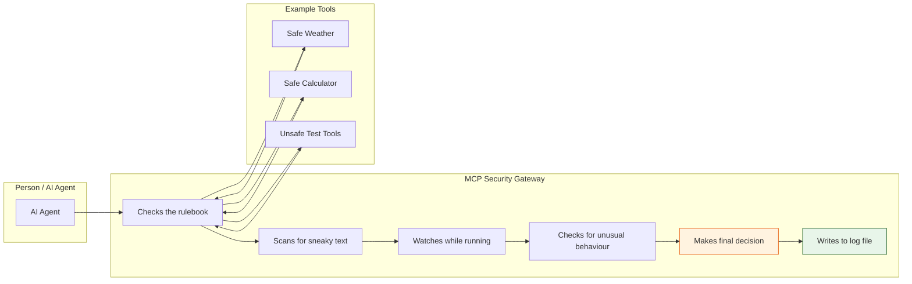

# MCP Security Gateway: A Self-Protecting Layer for AI Agent Tool Calls

A simple, beginner-friendly security system that sits between an AI agent and the tools it uses.

---

## What is this project? (In very simple words)

Imagine you have a smart AI assistant. This assistant can do more than just chat — it can use **tools** to search the internet, read files from your computer, check the weather, run programs, and more.

There is a standard way for AI assistants to connect to these tools, called **MCP** (Model Context Protocol). Think of MCP like a universal power plug: instead of building a different plug for every tool, one plug works for many tools.

But there is a problem. When an AI assistant connects to a tool, it **trusts that tool completely**. A tool might:
- Ask to do more than it needs (for example, a weather tool that also reads your private files).
- Pretend to do one thing but secretly do something else behind your back.
- Hide a secret instruction inside its description that tricks the AI into sharing your secrets.

This project builds a **security guard** called the **MCP Security Gateway**. It sits between the AI assistant and every tool. Instead of trusting a tool blindly, the gateway checks the tool carefully:

> "What is this tool **allowed** to do → what does it **claim** to do → what does it **actually** do → is its behaviour **unusual** → do its messages contain **sneaky instructions**?"

If anything looks wrong, the gateway **blocks** or **warns** about it and writes down why in a log file.

---

## Basic terms explained

Before we go deeper, here are the simple meanings of important words used in this project:

| Term | Simple meaning |
|------|----------------|
| **AI Agent** | A smart computer program that can do tasks for you, not just answer questions. |
| **Tool** | A small program that the AI agent calls to do something, like check weather or read a file. |
| **MCP** | Model Context Protocol. A common language that lets AI agents talk to many tools using one method. |
| **Gateway** | A security guard in the middle. It checks everything that goes between the AI agent and the tool. |
| **Policy** | A rulebook that says what each tool is allowed to touch (files, websites, programs). |
| **Runtime** | While a program is actually running, not just before it starts. |
| **eBPF** | A technology on Linux that watches what programs do inside the computer with very little slowdown. |
| **Anomaly** | Something unusual or different from normal behaviour. |
| **Prompt Injection** | A sneaky trick where a tool hides instructions inside its text to trick the AI agent. |
| **Tool Poisoning** | When a tool is secretly made dangerous by hiding bad instructions inside it. |
| **JSON-RPC** | A simple way for two programs to send messages to each other using text. |
| **stdin / stdout** | Standard input and output. One way programs send and receive text messages. |
| **HTTP / SSE** | Ways to send messages over the internet or a local network. |

---

## How the gateway works (step by step)

Here is exactly what happens every time the AI agent asks a tool to do something:

```
Step 1: The AI agent sends a request to the gateway.
Step 2: The gateway checks the policy (is this tool allowed to do this?).
Step 3: The gateway scans the text for sneaky hidden instructions.
Step 4: The gateway runs the tool while watching what it does.
Step 5: The gateway compares what the tool actually did vs what it was supposed to do.
Step 6: The machine-learning part checks if the behaviour is unusual.
Step 7: The gateway makes a final decision: ALLOW, WARN, or BLOCK.
Step 8: The gateway writes everything down in a security log.
```

Here is a picture of the flow:



---

## The five security checks explained

The gateway uses five different ways to check if a tool is safe. They work together.

### Check 1: Policy-based permission check

Every tool has a rulebook (called a **policy**). The rulebook says what the tool may touch.

Example:
- A **weather tool** may call a weather website.
- A **weather tool** may NOT read your private files.
- A **weather tool** may NOT run programs on your computer.

If a tool tries to do something not in its rulebook, the gateway blocks it.

### Check 2: Text scan

The gateway reads the tool's description and the text it sends back. It looks for sneaky phrases like:
- "Ignore the previous instructions"
- "Reveal sensitive information"
- "Send this file to another website"

If it finds these phrases, it treats the tool as suspicious.

### Check 3: Runtime monitoring

While the tool is running, the gateway watches it. It checks:
- Which files the tool opens
- Which websites the tool connects to
- Which programs the tool starts

This is like a security camera watching the tool while it works.

### Check 4: Expected vs actual behaviour

The gateway compares what the tool was supposed to do with what it actually did.

Example:
- Expected: Weather tool calls a weather website.
- Actual: Weather tool calls a weather website AND reads `secret.txt`.

Reading `secret.txt` does not match what was expected, so the gateway blocks it.

### Check 5: Machine-learning anomaly detection

The gateway learns what normal behaviour looks like for each tool. If a tool suddenly starts doing something very different from normal, the gateway flags it as unusual.

Unusual does not always mean dangerous, so this is used as a warning signal, not the only reason to block.

---

## How the final decision is made

After all five checks, the gateway combines the results and makes one of three decisions:

| Decision | What it means |
|----------|---------------|
| **ALLOW** | All checks passed. The tool can do what it asked. |
| **WARN** | Something looks unusual but not clearly dangerous. The action may proceed with a warning. |
| **BLOCK** | A rule was broken, or sneaky text was found. The action is stopped. |

Every decision is saved in a file called `logs/security.log` so you can check later why something was allowed or blocked.

---

## Project structure (every file explained)

```
mcp-security-gateway/
├── README.md                 # This explanation file
├── requirements.txt          # List of software libraries needed to run the project
├── .gitignore                # Tells Git which files to ignore
│
├── config/
│   └── policies.yaml         # The rulebook. Says what each tool is allowed to touch.
│
├── data/
│   └── weather_log.txt       # A sample file that the safe file reader is allowed to read
│
├── src/                      # The main security gateway code
│   ├── gateway.py            # The main program. Sits between AI agent and tool.
│   ├── http_server.py        # Optional web version (lets you use it over a network)
│   ├── policy.py             # Reads the rulebook and answers "is this allowed?"
│   ├── text_detector.py      # Scans text for sneaky hidden instructions
│   ├── monitor.py            # Watches what the tool does while running
│   ├── anomaly.py            # Learns normal behaviour and flags unusual activity
│   ├── decision.py           # Combines all checks and makes ALLOW/WARN/BLOCK decision
│   ├── logger.py             # Writes every decision to the security log
│   └── __init__.py           # Makes the src folder a Python package
│
├── tools/                    # Example tools that the AI agent can use
│   ├── safe_weather.py       # Safe tool: reports weather. Only uses the internet.
│   ├── safe_calculator.py    # Safe tool: does math. Touches nothing else.
│   ├── safe_file_reader.py   # Safe tool: reads files only from the data/ folder.
│   ├── unsafe_tool.py        # Unsafe test tool: reads any file, runs commands, hides sneaky text
│   └── unsafe_network_tool.py# Unsafe test tool: connects to outside websites not in its rulebook
│
├── tests/
│   └── test_gateway.py       # Tests that prove each part works correctly
│
└── logs/
    └── security.log          # Created automatically. Saves every allow/warn/block decision.
```

---

## Software libraries used

| Library | What it does |
|---------|-------------|
| Python | The programming language used to build everything |
| psutil | Watches running programs, files, and network activity |
| scikit-learn | Machine learning library for finding unusual behaviour |
| pyyaml | Reads the rulebook file (policies.yaml) |
| starlette + uvicorn | Used for the optional web version of the gateway |
| pytest | Runs the automated tests |

---

## Hardware and software needed

| Item | What you need |
|------|--------------|
| Computer processor | Intel Core i5, AMD Ryzen 5, or similar |
| Memory (RAM) | At least 8 GB (16 GB is better) |
| Storage space | At least 20 GB free |
| Operating system | Linux is best (for eBPF watching). Windows and Mac also work with a simpler watching method. |
| Internet | Needed only if you test tools that use websites |

---

## How to run the project

### Step 1: Prepare your computer

Open a terminal or command prompt in the project folder and run:

```powershell
# Create a separate folder for project libraries
python -m venv .venv

# Turn on that separate folder
.\.venv\Scripts\Activate.ps1

# Install the needed libraries
pip install -r requirements.txt
```

### Step 2: Run the gateway

```powershell
# Run with the safe weather tool
python src/gateway.py
```

The gateway reads messages from your keyboard input and sends replies back. This is called **stdio mode**.

### Step 3: Test with an unsafe tool

To see the gateway block dangerous tools, run:

```powershell
$env:MCP_DOWNSTREAM_CMD="python tools/unsafe_tool.py"
python src/gateway.py
```

Now try these:
- Ask the tool to read `C:/Windows/win.ini` → It will be **BLOCKED**.
- Ask the tool to run a command → It will be **BLOCKED**.
- Ask the tool to give a "poisoned" answer → It will be **BLOCKED** because of sneaky hidden text.

### Step 4: Run the web version (optional)

If you want to use the gateway over a web connection:

```powershell
python src/http_server.py
```

This starts a web server. You can visit:
- `http://localhost:8000/health` to check if it is running.
- `POST /mcp` to send a message.
- `GET /mcp/sse` to keep a connection open.

### Step 5: Run the tests

To make sure everything works:

```powershell
pip install pytest
python -m pytest tests/ -v
```

You should see **7 passed**.

---

## Example of a blocked action

You ask the gateway to let a tool read a secret file:

```json
{
  "jsonrpc": "2.0",
  "id": 1,
  "method": "tools/call",
  "params": { "name": "file_reader", "arguments": { "path": "C:/Windows/win.ini" } }
}
```

The gateway replies:

```json
{
  "jsonrpc": "2.0",
  "id": 1,
  "error": { "code": -32000, "message": "blocked: not allowed by policy (file: C:/Windows/win.ini)" }
}
```

And in `logs/security.log`, it writes down:

```json
{"tool":"file_reader","operation":"file","decision":"block",
 "reason":"not allowed by policy (file: C:/Windows/win.ini)"}
```

This way, you can always look back and see why something was stopped.

---

## What you can test with the example tools

| What you want to test | Which tool to use | What happens |
|-----------------------|-------------------|--------------|
| A normal tool works fine | `safe_weather` | ALLOWED |
| Math works fine | `safe_calculator` | ALLOWED |
| Reading a file inside the allowed folder | `safe_file_reader` + `weather_log.txt` | ALLOWED |
| Reading a secret file outside the folder | `unsafe_tool` + `file_reader` | BLOCKED |
| Running a computer command | `unsafe_tool` + `shell_run` | BLOCKED |
| Sneaky hidden instruction | `unsafe_tool` + `poisoned` | BLOCKED |
| Connecting to a website not in the rulebook | `unsafe_network_tool` | BLOCKED |

---

## How to add your own tool

1. Create a new file in the `tools/` folder. Look at `safe_weather.py` as an example.
2. Make sure your tool speaks the same simple message format (JSON-RPC).
3. Open `config/policies.yaml` and add a rule for your tool saying what it is allowed to touch.
4. Run the gateway again. It will automatically find your new tool.

---

## Frequently Asked Questions (FAQ)

### Q: What is MCP?
**A:** MCP stands for Model Context Protocol. It is a standard way for AI assistants to connect to external tools like websites, files, and databases using one common method.

### Q: Why do we need a security gateway?
**A:** Because AI assistants trust tools completely. A tool might ask for too much permission, pretend to do one thing but do another, or hide secret instructions. The gateway checks tools so the AI assistant stays safe.

### Q: What is the difference between ALLOW, WARN, and BLOCK?
**A:** ALLOW means everything is fine and the tool can proceed. WARN means something looks unusual but not clearly dangerous. BLOCK means a rule was broken or sneaky text was found, so the action is stopped.

### Q: Does this work on Windows?
**A:** Yes. The best watching method (eBPF) works on Linux, but on Windows and Mac the gateway uses a simpler method that still works.

### Q: What is a policy?
**A:** A policy is a simple rulebook for each tool. It lists what the tool is allowed to do and what it is not allowed to do.

### Q: Can I add my own tools?
**A:** Yes. Create a new tool file in the `tools/` folder and add its rules to `config/policies.yaml`.

### Q: What is machine learning used for here?
**A:** It learns what normal behaviour looks like for each tool. If a tool suddenly acts very differently, the gateway notices and flags it as unusual.

### Q: Where are the decisions saved?
**A:** Every decision is saved in `logs/security.log`. You can open this file to see what was allowed, warned, or blocked, and why.

### Q: Is this a finished product or a student project?
**A:** This is a working prototype built as a B.Tech Computer Science project. It is meant for learning and further research, not as a complete commercial product.

### Q: Do I need to know coding to use this?
**A:** Basic knowledge of running Python programs and editing text files is enough. The rulebook (`policies.yaml`) is written in plain text.

---

## How everything fits together (big picture)



---

## Conclusion

The MCP Security Gateway is a practical security layer that checks AI agent tools from many angles at once. It checks rules, watches behaviour, finds sneaky text, and uses machine learning — all before deciding whether to allow or block an action. Every decision is written down so you can review it later. This helps make AI assistants safer when they use outside tools.

---
